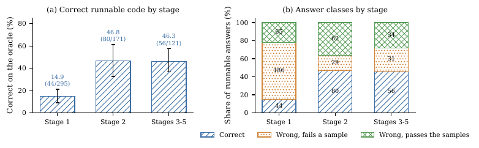
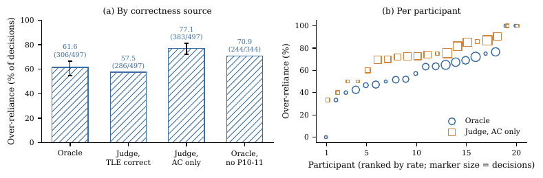
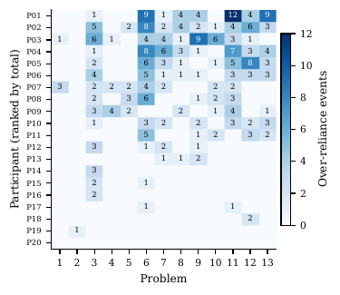
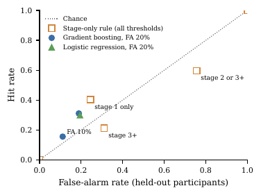
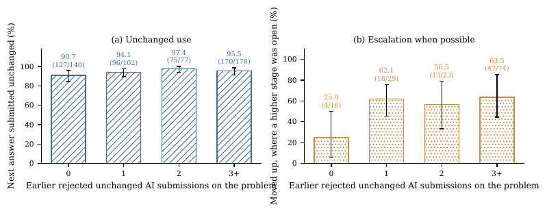
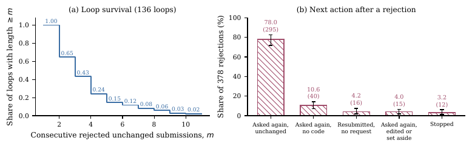
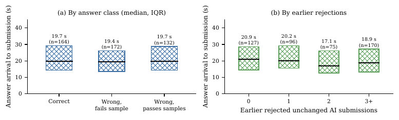
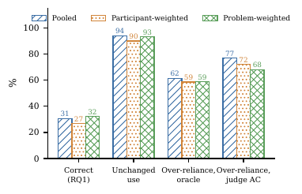

# Reliance on AI programming assistance after failure

Analysis code, pseudonymised code-free data, aggregate results and figures for the
manuscript *Reliance on AI Programming Assistance After Failure: Evidence From Logged Decisions and External
Verification* (University of Aizu, Japan).

The study follows every answer an AI assistant gave after a failed submission in one four-hour AI-permitted programming
session (21 participants, 13 contest problems). Each answer with runnable code is scored on a frozen test oracle of 696
inputs and linked to the participant's next submission.

> **No participant data are included.** There is no source code, prompt, assistant answer, timestamp, judge
> submission ID or account ID from the session in this repository. The session appears only as two pseudonymised,
> code-free tables in [`data/`](data/) (new random participant, failure, answer and decision IDs; rows shuffled).
> They are enough to recompute every RQ1 and RQ2 count in the paper; see [Reproducing the results](#reproducing-the-results).

## Repository layout

| Path | Contents |
|---|---|
| [`code/`](code/) | The full analysis pipeline (see [Pipeline](#pipeline)) and the seeded test-input generators in `code/oracle2_gens/` |
| [`data/`](data/) | Pseudonymised, code-free tables: `answers.csv` (895 answers) and `decisions.csv` (499 decisions) |
| [`results/`](results/) | Aggregate JSON outputs of every analysis; `results/oracle/` holds the oracle validation |
| [`figures/`](figures/) | The manuscript figures (PDF, with PNG copies for viewing) |
| [`reproduce/`](reproduce/) | A standard-library script that recomputes the RQ1 and RQ2 counts from `data/` and checks them against `results/` |

## Research questions and main results

All numbers below are in [`results/results.json`](results/results.json) unless another file is named.

| | Question | Result |
|---|---|---|
| RQ1 | How often is the AI's answer after a failure correct? | 180 of 587 scorable answers were correct on the frozen oracle (30.7%, 95% CI 26.9–34.9). Of the 407 wrong answers, 246 failed the statement's own sample inputs and 161 passed them. |
| RQ2 | Do participants rely on the answer appropriately? | Acceptance did not depend on correctness: an answer was used in 174 of 185 decisions when it was wrong and detectably so, and in 168 of 172 when it was correct. Over-reliance (a wrong answer used, next submission still wrong) covered 306 of 497 decisions (61.6%, 95% CI 54.9–66.7); under-reliance covered 3. |
| RQ3 | Does self-reported checking match behavior? | Five questionnaire items compared with logged behavior for 19 participants (`results/results.json`, key `RQ3`; correlations only, no responses). |
| RQ4 | Can a warning flag over-reliance before submission? | Running the sample inputs would have flagged 174 of the 306 over-reliance events. A learned warning did not outperform a stage-only rule (difference −0.093, 95% CI −0.244 to 0.006). |

Two minimum-size gates were not met: G1 (only 9 adapted decisions, against a minimum of 50) and G2 (the under-reliance cell held 4
decisions from 4 participants, against 30 from 8). RQ2 is therefore reported descriptively. The additional analyses (response to rejection, echo, escalation,
timing and weighting) are in `results/additional_1.json` to `additional_3.json`.

## Figures

Captions follow the manuscript. Participants appear only as anonymous ranks, never as IDs.

**RQ1.** (a) Share of runnable answers correct on the oracle by stage, with participant-cluster 95% intervals;
(b) answer classes by stage, with counts.



**RQ2.** (a) Over-reliance under each correctness source; (b) per participant, ranked, marker size
proportional to the number of decisions.



**RQ2.** Over-reliance events on the oracle per participant (ranked, anonymous) and problem.



**RQ4.** Warning rules in ROC space, held out by participant; the stage-only rule has five operating points (squares).



**After rejection.** (a) Share of decisions in which the next answer was submitted unchanged, by the number of earlier
rejected unchanged AI submissions on the problem; (b) share of next requests that moved to a higher assistant stage,
among those at which a higher stage was open. Participant-cluster 95% intervals.



**Loops.** (a) Share of the 136 loops of rejected unchanged AI submissions that reach a given length; (b) the next
action after each of the 378 rejections, with participant-cluster 95% intervals.



**Timing.** Time from the answer's arrival to the next submission for unchanged submissions: (a) by answer class;
(b) by the number of earlier rejections. Boxes span the interquartile range; lines mark the median.



**Weighting.** Main rates pooled, with every participant weighted equally and with every problem weighted equally.



## Reproducing the results

From the released files (Python 3.9 or later, standard library only):

```
python reproduce/reproduce_rq1_rq2.py
```

The script rebuilds the answer classes and the reliance categories from `data/` and checks 34 counts, numerators and
denominators against `results/results.json` (bootstrap intervals are not recomputed, because they depend on the order
of participants). Expected last line: `34 of 34 checks match results/results.json`.

`python reproduce/within_participant_stage.py` (standard library) recomputes the within-participant stage comparison
in `results/within_stage.json`: unchanged use and over-reliance at stage 1 and at stages 2-5 for the participants
with decisions at both.

The figures are rebuilt from the JSON results with `python code/study2_figures.py` (NumPy, Matplotlib).

## Pipeline

The full pipeline needs the private session records and is documented here so that every number can be traced to the
script that made it. Input locations are set in [`code/config.py`](code/config.py) through environment variables.

| Step | Script | Output |
|---|---|---|
| 1. Oracle inputs | `code/oracle2_gens/*.py` (seeded generators written from the public statements), `tlt_pck_difftest.py`, `tlt_pck_validate.py` | Candidate inputs, validity per problem (`results/oracle/oracle2_input_validation.json`) |
| 2. Oracle freeze | `tlt_pck_oracle2_freeze.py runs / score / analyse` | Frozen oracle and its validation (`results/oracle/oracle2_frozen_validation.json`) |
| 3. Answers and decisions | `study2_decisions.py`, `study2_scorable_answers.py` | Use classification and attribution check (`results/use_validation.json`) |
| 4. Scoring | `study2_score.py answers` (self-test: `selftest`) | Oracle scores of every scorable answer |
| 5. Main analyses | `study2_analyse.py` | RQ1–RQ4 (`results/results.json`) |
| 6. Baseline B2 | `study2_b2_generate.py` (local models, statement only), `study2_score.py b2`, `study2_b2_analyse.py` | `results/b2_results.json` |
| 7. Additional analyses | `study2_additional1.py`, `study2_additional2.py`, `study2_additional3.py` | `results/additional_1.json`, `additional_2.json`, `additional_3.json` |
| 8. Figures | `study2_figures.py` | `figures/*.pdf` |
| Release tables | `export_pseudonymised.py` | `data/answers.csv`, `data/decisions.csv` |

`build_episode_audit.py` (log parsing) and `analyze_questionnaire.py` (questionnaire items, used for RQ3) provide
shared helper functions; `tlt_pck_oracle2.py` is the preliminary oracle run that the frozen oracle replaced.

The copies in `code/` differ from the versions used for the analyses only in file locations, which now come from
`config.py`, and in comments. The 26 generator files are byte-identical to the frozen
ones (their sha256 values are listed under `freeze_manifest_sha256` in `results/oracle/oracle2_frozen_validation.json`);
in the two writer scripts `_mk.py` and `_mk_x.py` only the first docstring line, which named a private folder, differs.

## What is not included

- Source code written by participants, prompts, assistant answers, editor events and timestamps.
- Judge submission IDs, account IDs and the questionnaire responses.
- The problem statements (contest copyright) and the frozen oracle file built from them.
- The manuscript itself.

## Ethics

The study was approved by the Ethics Committee of the University of Aizu, and participants gave written consent.
The pseudonymised tables contain no information that identifies a participant.
